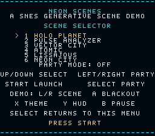
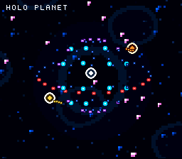
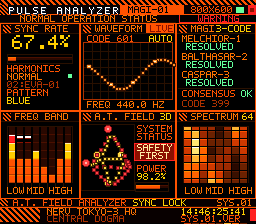
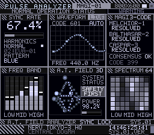
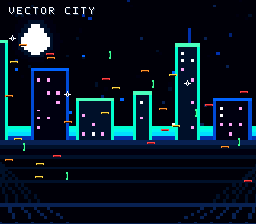
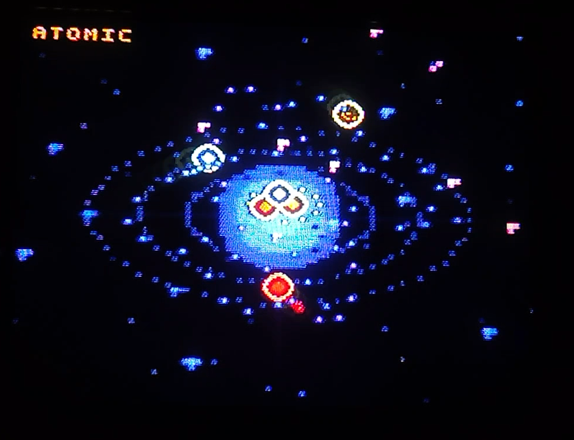
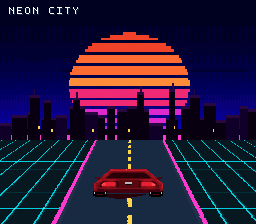
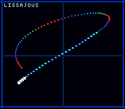
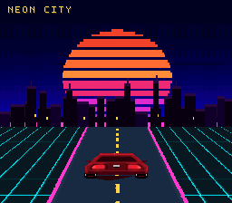

# Neon Scenes

A SNES cartridge demo for real hardware: six generative sci-fi scenes, a
scene selector, smooth fade transitions and a hands-off party mode.  The
original Lissajous comet is still here, joined by a holographic Holo Planet
console, a Pulse Analyzer, a neon Vector City, a Bohr-style Atomic scene and a
synthwave Neon City.











## Play

- **ROM:** `NeonScenes.sfc` (512 KiB, LoROM, NTSC)
- **Tested:** Snes9x 1.63 (reports **Checksum OK**) and SUPER ZSNES 0.320b; the
  ROM uses standard LoROM/Mode 7/OAM/HDMA features and is intended to run on
  real hardware and accurate emulators as well.
- **Hardware target:** LoROM, 512 KiB, NTSC, no expansion chip.  Intended for
  SNES flash carts (FXPAK Pro, EverDrive, etc.) and real NTSC consoles.
- **Startup:** the reset handler disables NMI/HDMA, clears the low 8 KiB of
  WRAM, and waits for two vblanks before touching the PPU.  This avoids the
  intermittent black screen seen when a flash cart hands over with stale
  registers or when the PPU is still warming up.  Scene starts and the title
  upload also take NMI and HDMA down **before** forcing blank, so a vblank NMI
  cannot re-enable the display in the middle of a VRAM transfer.

Load the `.sfc` and press **START**.

### Scene selector

| Input | Action |
| --- | --- |
| Up / Down | Choose a scene |
| Left / Right | Toggle party mode |
| Select | Toggle party mode |
| Start | Launch the selected scene |

The selector remembers the last scene and the party-mode setting when you
return to it with **Select** during a scene.

### During a scene

| Input | Action |
| --- | --- |
| L / R | Previous / next scene (fades through black) |
| Start | Toggle party mode |
| Select | Return to the scene selector |
| A | Blackout on / off (smooth fade) |
| B | Pause / resume |
| X | Cycle the four colour themes |
| Y | Show / hide the scene-name HUD |
| Up / Down | Holo Planet: rotation speed (0-4); Lissajous: frequency B; otherwise brightness |
| Left / Right | Holo Planet: spin the globe by hand while held; Lissajous: frequency A |

Party mode auto-cycles through the six scenes every ten seconds, advances the
colour theme on each cycle, and shows the scene name in gold.  Brightness is
available in party mode and in every scene except Holo Planet (where the D-pad
drives the globe); blackout works everywhere, and the scene-name HUD can be
hidden with **Y**.

## Scenes

- **Holo Planet** — a NERV "holographic planet monitor" built as a real tiled
  Mode 1 console: hazard-striped header, orbital gauges, holo-layer toggles,
  defence status, floating LAT/LON and target readouts, and a full-width
  resonance spectrum.  The planet itself is a dot-matrix globe: crisp static
  latitude parallels and orbital rings on BG2, plus 120 precomputed rotation
  phases of surface particles and dotted meridians.  Each phase has **two
  complementary OAM fields that are flickered** (persistence of vision), so
  the globe shows twice the 96 sprites the hardware can draw at once.  **Left /
  Right spin the globe by hand; Up / Down set the automatic rotation speed**
  (the speed gauge in the left panel follows).
- **Pulse Analyzer** — a NERV-style "MAGI-01" monitoring console built from
  `References/interface1.jpeg`, `interface2.jpeg` and the animated
  `Interface3.html`: hazard-striped header, SYNC RATE readout, eight
  segmented spectrum bars with peak hold, an oscilloscope trace, a rotating
  A.T. field octahedron, the MAGI consensus panel and a scrolling spectrum
  matrix.  Like Holo Planet it is a real tiled Mode 1 interface, so
  the labels are crisp 5x7 text rather than magnified Mode 7 pixels.
- **Vector City** — a neon skyline in Mode 7 with parallel scrolling, flying
  cars, a moon, perspective ground lines and a per-scanline HDMA wave.
- **Atomic** — three tilted electron orbits, glowing electrons and trails, a
  three-part nucleus and an energy ring.
- **Lissajous** — the original 96-sprite comet trail, now on a precomputed
  Mode 7 oscilloscope grid.
- **Neon City** — a synthwave outrun scene rebuilt around
  `References/NeonCityConcept.jpg`: a striped sunset over a dense, silhouetted
  skyline and a Mode 7 floor whose grid converges on the vanishing point and
  drives towards the camera, with a rear-view sports car on the road.

## Build

Requirements:

- Python 3.9+
- WLA-DX 10.7 (`wla-65816` and `wlalink`)

The bundled build expects the Windows WLA-DX binaries in
`tools/wla/wla_dx_v10.7_Win64/`.  If they are missing, download WLA-DX v10.7
from <https://github.com/vhelin/wla-dx/releases> and extract the Windows
archive there.

```text
python build.py
```

The script regenerates `src/generated.inc`, `src/scenes_shared.inc` and the
per-bank scene includes, assembles the ROM, links it, checks the size, reset
vector and checksum pair, and writes `NeonScenes.sfc`.

After a build, run the static hardware audit:

```text
python check_hardware.py
```

It checks the shipped ROM for the common LoROM/real-hardware pitfalls: header
fields, the standard checksum, reset and exception vectors, the reset/PPU
warm-up stub, every sized ROM blob staying inside one 32 KiB bank (DMA source
addresses are 16-bit), the six scene descriptors, all 35 HDMA tables (224
one-line 16-bit entries plus a terminator, inside one bank) and the Pulse
Analyzer's 128 NMI write lists.

The assembler is invoked with `-h` (16-bit label references by default); the
source explicitly marks 8-bit immediates with `.B` where needed.

## Files

```text
NeonScenes.sfc     final ROM (512 KiB)
NeonScenes.sym     WLA symbol map for debugging
build.py                  one-command build + ROM validation
check_hardware.py         static LoROM/hardware audit for the shipped ROM
generate_assets.py        fonts, palettes, Lissajous frequency tables, tilemaps
generate_scenes.py        scene art, OAM frames, themes, selector maps, HDMA
src/main.asm              65816 source
src/generated.inc         generated shared data (checked in for convenience)
src/scenes_shared.inc     generated scene metadata for bank 1
src/bankNN.inc            generated scene backgrounds and OAM frames
src/scene_banks.inc       bank/include glue for the scene data
screenshots/              native 256x224 captures
tools/wla/                WLA-DX 10.7 binaries used by build.py
```

## Architecture

- **Banks.** Bank 0 holds the 65816 code and the original Lissajous tables.
  Bank 1 holds shared scene metadata, selector maps, theme palettes, sprite
  tiles, texture descriptors and the Vector City HDMA table.  Banks 2–14 hold
  the precomputed Mode 7 backgrounds, the Pulse Analyzer console tiles and
  maps, the Holo Planet console and globe, the OAM frames and the Neon City
  scanline tables.  `generate_scenes.py` packs the blobs with first fit so the
  holes left by the large backgrounds are reused, and it refuses to place an
  item across a bank boundary because a DMA source address has only 16 bits.
  The ROM header is in bank 0 at `$FFC0`.
- **Scene engine.** Every scene is described by a 16-byte descriptor: Mode 7
  background pointer and size, OAM-frame table pointer and count, scroll
  parameters, flags, scale and HUD name.  `StartScene` loads the descriptor,
  uploads the background and palettes and starts the appropriate update path.
  Flags are `$01` Lissajous real-time trail, `$02` Vector City scroll, `$04`
  Neon City perspective floor, `$08` Pulse Analyzer tiled console and `$10`
  Holo Planet tiled console.  Both consoles leave the Mode 7 background fields
  at zero: `InitMagiScene`/`InitHoloScene` upload their tiles and tilemaps and
  switch the PPU to Mode 1.
- **OAM frames.** Pulse Analyzer, Vector City, Atomic and Neon City stream
  precomputed frames of 96 sprites each from ROM (384 bytes of OAM entries +
  24 bytes of OAM high-table bits per frame).  Holo Planet has 240 frames:
  120 rotation phases with two complementary fields each, flickered one per
  vblank so the globe shows twice the 96 sprites of a single frame.  This keeps
  the 65816 main loop at 60 Hz and makes the animation deterministic.  Slots
  0–95 are the scene particles; slots 96–127 are the HUD.  Neon City needs a
  single frame: the car is static and all of the motion comes from the Mode 7
  floor.
- **VRAM.** Mode 7 backgrounds occupy VRAM word 0 onward (14,080 bytes for the
  88×77 scenes, 28,160 bytes for the 176×77 Vector City).  Neon City uploads
  the entire 32 KiB Mode 7 plane: the top-left corner holds a 176-texel-wide
  skyline and the rest is one seamless 64×32-texel grid/road cell.  Sprite
  tiles start at word `$4000` (byte `$8000`): the 4bpp font and original dot
  tiles, followed by scene tiles at word `$4430` (now including the car in
  tiles 144–201).  For the Pulse Analyzer the same 32 KiB BG area is reused:
  BG1 characters at `$0000`, BG2/BG3 characters at `$3000` (BG3's heat cell at
  `$3000`, the BG2 cell atlas at `$3010`) and the three 32×32 maps at `$3400`,
  `$3800` and `$3C00`.  Holo Planet uses BG1 characters at `$0000`, BG2
  characters at `$2000`, the BG1 map at `$3800` and the BG2 map at `$3C00`.
- **Holo Planet layers.** BG1 is the console (4bpp, one 16-colour palette):
  header, gauges, holo-layer toggles, defence status, floating readouts and
  footer, with the centre left transparent.  BG2 holds the static globe
  furniture (limb, latitude parallels, orbital rings and the north-pole tick)
  at low priority, so the console clips it, and the animated spectrum/gauge/
  beacon cells at high priority over the console.  The planet surface is the
  OAM dot matrix: six dotted meridians and 20 particles per field, plus four
  satellite markers and two labels.  Latitude parallels do not move under a
  yaw spin, which is why they can stay in BG2 while the meridians are dots.
- **Pulse Analyzer layers.** BG1 is the static console (4bpp, palette 2,
  256×224 of crisp 5×7 text and panel furniture).  BG2 carries the animated
  bar wells and gauges (4bpp, palette 3) and BG3 the spectrum matrix (2bpp,
  palettes 0–7).  Because Mode 1 draws BG1 in front of BG2, the static layer
  leaves transparent windows over every dynamic area; BG2 in turn only covers
  its own wells and uses a transparent tile everywhere else.  Sprites are used
  only for the two vector displays, so the scene needs 94 of the 96 OAM slots.
- **HDMA.** Vector City uses channel 4 to write a gentle per-scanline `M7VOFS`
  wave.  Neon City uses channels 1–3, one 16-bit write per scanline each:
  `M7A` (perspective scale), `M7B` (the shear that puts the vanishing point on
  the screen centre) and `M7D` (the depth scale, so `texel_y = y·M7D/256`).
  Above the horizon the same tables hold the skyline at its native width; below
  it they implement a real 1/(depth) floor.  `M7D` comes from 32 precomputed
  tables and the main loop only swaps the HDMA source pointer, so a step costs
  three register writes.  The plane band the floor samples is periodic, which
  makes the wrap at the end of each table invisible.  The Pulse Analyzer uses
  no HDMA: its spectrum scroll is a plain `BG3VOFS` write in the NMI.
- **Pulse Analyzer animation.** The scene runs on its own 128-frame loop
  (2.13 s), which makes the spectrum scroll exactly 256 pixels — one full
  tilemap wrap — so the loop point is invisible.  Every frame has a small list
  of VRAM writes (a count byte followed by *address, map entry* pairs) for the
  cells that changed, plus a `BG3VOFS` byte; the NMI applies them with a couple
  of dozen 16-bit writes.  A typical frame needs under 60 writes.
- **Colour.** Four themes (NEON, SOLAR, AURORA, MONO) are precomputed for the
  background and OBJ palettes.  Party mode advances the theme on each scene
  change; **X** cycles it manually.  Neon City has its own 32-colour background
  palette (deep indigo sky, orange/pink sun, cyan grid, magenta road lines) and
  object palette 4 is a dedicated red ramp so the car can be shaded.  The Pulse
  Analyzer owns CGRAM 0–63: eight 4-colour BG3 heat ramps, the BG1 UI palette
  and the BG2 bar palette, each precomputed for all four themes.  Holo Planet
  uses a single 16-colour BG palette (CGRAM 0–15) shared by the console and the
  globe overlay, and the same four theme variants.  The MONO theme turns both
  consoles into white phosphor monitors.
- **Safety.** Scene VRAM/CGRAM uploads run with NMI and HDMA off and forced
  blank.  During gameplay only OAM is updated, by a 544-byte DMA inside the
  vblank NMI, plus the small Pulse Analyzer and Holo Planet cell lists.
  Precomputed OAM frames are copied into the OAM shadow with two small DMAs
  (entries and high table) before the OAM DMA.

## Header / checksum

```text
Title:      NEON SCENES
Mapper:     LoROM (slow ROM)
Cart type:  ROM only ($00)
ROM size:   512 KiB (header value $09)
Region:     USA / NTSC ($01)
Checksum:   $B9F9 / complement $4606
SHA-256:    5fcfc2ae50af00a06697bd28647691702a5dced3a2975ba73e2cd8d0471039ba
```

The checksum is recomputed after linking by `build.py` with the standard
SNES algorithm: the ROM is summed with the four checksum bytes treated as
`FF FF 00 00` (equivalently, sum the rest and add `$01FE`).  This is the value
Snes9x and flash-cart tools expect; Snes9x 1.63 reports **Checksum OK**.  WLA-DX's
own value includes the bytes as stored, which made some tools disagree.

## Notes

- Snes9x 1.63 verification: all six scenes, the selector, the title screen, the
  Pulse Analyzer's four colour themes, the Holo Planet's four themes and its
  D-pad rotation/speed controls were checked with native 256x224 captures.
- This is a 60 Hz NTSC release.  On a PAL console the picture will still run,
  but at 50 Hz and with PAL borders.
- A genuine original cartridge needs the CIC lockout chip and a compatible
  board; a flash cart is the simplest way to run it on real hardware.
- The demo is silent by design; no SPC700 sound driver is included.
- The comet trail is intentionally made of discrete embers rather than a
  solid polygon.  That keeps the effect within the SNES sprite limits and
  makes the fast-sweep persistence work nicely on a CRT.
- The Neon City floor is a real perspective projection, not a scrolling
  picture: `M7A`, `M7B` and `M7D` are rewritten per scanline so the grid
  converges on a vanishing point hidden behind the skyline, and stepping the
  `M7D` tables makes the cells rush towards the viewer at the correct
  accelerating rate.  The car is the only sprite in the scene, so one OAM frame
  is enough and the whole frame budget goes into the floor.
- The Pulse Analyzer and Holo Planet are the two tiled Mode 1 scenes.  Their
  consoles are Mode 1 interfaces because the reference art is typography-heavy
  and a 256×224 Mode 7 plane would have to be magnified three times to fill the
  screen.  The Pulse Analyzer's VU bars are 8×8 BG cells whose map entries are
  swapped as the levels change, the peak-hold markers are cells of their own,
  and the spectrum waterfall is a BG3 tilemap scrolled two pixels per frame.
  The moving parts are the two sprite displays: the oscilloscope trace (28
  dots) and the A.T. field octahedron (six glowing nodes plus five dots per
  edge).
- Holo Planet fakes more sprites than the PPU allows: each of the 120 rotation
  phases has two OAM frames, and the NMI alternates them every vblank.  The
  globe therefore shows 120 meridian dots and 40 surface particles instead of
  60 + 20.  The two fields are complementary, so a CRT (or the emulator) blends
  them through persistence of vision; a still capture only shows one field.
  The wireframe latitude parallels stay in BG2 because a yaw spin leaves them
  in place, while the meridians are the moving dots.  **Left/Right** drive the
  phase directly and **Up/Down** change the automatic speed.
- The scene-name HUD is deliberately tiny: it is the only sprite text drawn
  during a scene, and it can be hidden completely with **Y**.  In the Pulse
  Analyzer it sits in the console's own title band, next to the MAGI-01 badge;
  in Holo Planet it sits in the header's left title band.

## References

- [WLA-DX](https://github.com/vhelin/wla-dx) — assembler/linker used here.
- [fullsnes / nocash SNES specifications](https://problemkaputt.de/fullsnes.htm) —
  Mode 7, OAM, DMA, HDMA and CGRAM details.
- [Super Famicom Development Wiki: Backgrounds](https://wiki.superfamicom.org/backgrounds) —
  Mode 7 VRAM/map layout.
- [Awesome SNESdev](https://github.com/Scottcjn/awesome-snesdev) — the tool and
  documentation list used while building the tiled console.
- The Pulse Analyzer layout follows the supplied `References/interface1.jpeg`,
  `interface2.jpeg`, `Interface3.png` and the animated `Interface3.html`.
- The Holo Planet console and globe follow `References/HoloPlanet.png` and the
  animated `References/HoloPlanet.html`.


